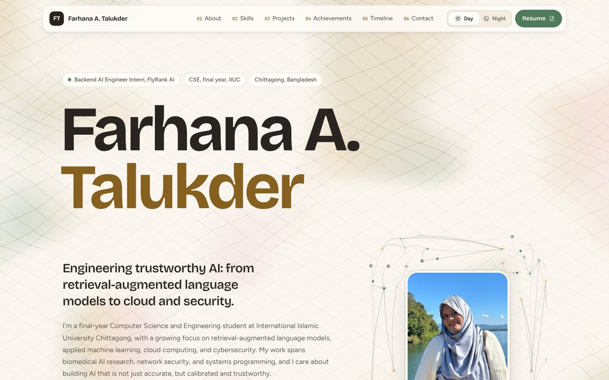

<div align="center">

# Farhana Akhter Talukder | Portfolio

Final-year CSE student at IIUC working on retrieval-augmented language models, applied machine learning, cloud computing and cybersecurity.

[](https://farhana-talukder-portfolio.vercel.app)
[](https://tailwindcss.com)
[](#built-with)

<br>

<a href="https://farhana-talukder-portfolio.vercel.app">
  <picture>
    <source media="(prefers-color-scheme: dark)" srcset="docs/preview-dark.jpg">
    
  </picture>
</a>

</div>

## Highlights

- Single scrollable home page with an anchor navbar: about, skills, projects, achievements, study timeline and contact
- A detail page for every project, with a filterable index for research work and software projects
- Day and night themes, remembered between visits
- Animated lattice background, hero node ring and a custom cursor, all switched off for visitors who prefer reduced motion
- Print-styled CV page that saves straight to PDF
- Contact form delivered to my inbox through Web3Forms, with a mailto fallback
- Fully responsive, with a skip link and keyboard-friendly controls

## Built with

| Layer | Choice |
| --- | --- |
| Markup | HTML5 |
| Styling | Tailwind CSS v3, compiled with the CLI into one static file |
| Behaviour | Vanilla JavaScript, no framework |
| Type | Bricolage Grotesque, Figtree and JetBrains Mono |
| Icons | Phosphor Icons (duotone) |
| Forms | Web3Forms |
| Hosting | Vercel |

## Setup

You need [Node.js](https://nodejs.org) 18 or newer.

**1. Install and build the CSS**

```bash
git clone https://github.com/f-akhter-t/farhana-talukder-portfolio.git
cd farhana-talukder-portfolio
npm install
npm run build
```

Use `npm run watch` instead of `npm run build` while editing so the CSS rebuilds on every save.

**2. Add the contact form key**

Create a free access key at [web3forms.com](https://web3forms.com), then paste it into `js/config.js`:

```js
window.SITE_CONFIG = {
  email: 'you@example.com',
  web3formsKey: 'your-access-key'
};
```

Web3Forms keys are meant to be public, so it is safe to commit this file.

**3. Preview locally**

The site is plain static files, so any static server works:

```bash
npx serve .
```

Then open the address it prints. Opening `index.html` directly in a browser also works.

## Project structure

```
.
├── index.html            Home page
├── cv.html               Print-styled CV (choose Save as PDF)
├── ek-mutho-hasi.html    Ek Mutho Hasi volunteer project page
├── projects/             Project index and one page per project
├── src/input.css         Tailwind source and theme tokens
├── dist/output.css       Compiled CSS (npm run build)
├── js/                   main.js, lattice.js and config.js
├── assets/               Images, certificates and favicon
└── docs/                 README and social preview images
```

## Deployment

The site is hosted on Vercel as a static site. Every push to `main` redeploys it automatically, and pull requests get their own preview URLs. No environment variables are needed.

If you change any HTML or Tailwind classes, run `npm run build` before committing so `dist/output.css` stays current.

## Contact

[Email](mailto:f.akhter.t13@gmail.com) | [LinkedIn](https://www.linkedin.com/in/farhana-a-talukder-613184284/) | [GitHub](https://github.com/f-akhter-t)

## Copyright

All text, photos and certificates are copyright 2026 Farhana Akhter Talukder. Please do not reuse them without permission.
